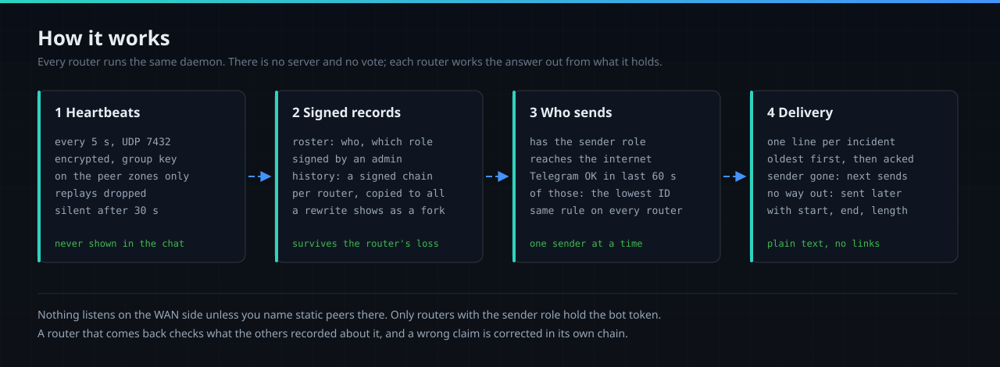
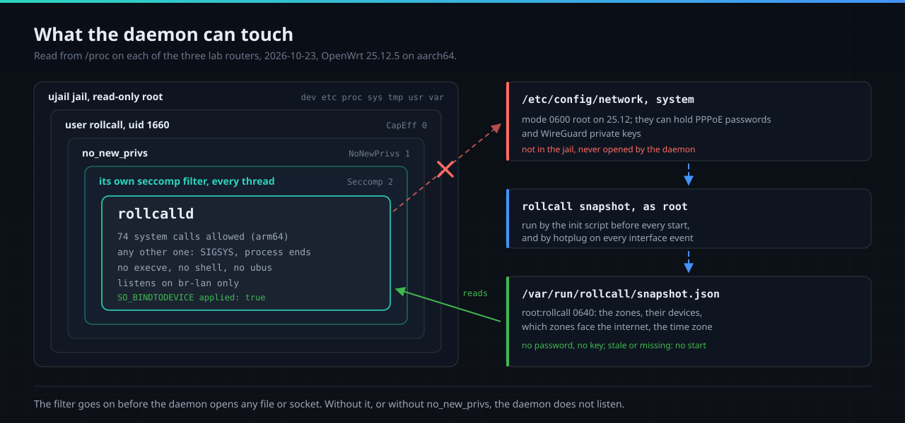
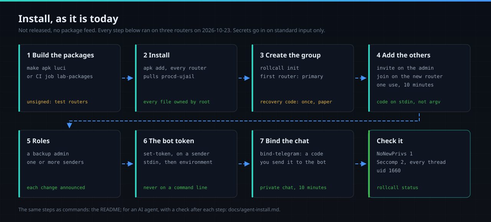

<div align="center">



# rollcall

The routers of one OpenWrt site exchange signed heartbeats and keep a signed roster and history.
When one goes down, reboots, upgrades or loses the internet, a router that is still online tells
your Telegram chat, once per incident.

[](https://github.com/TAIPANBOX/rollcall/actions/workflows/ci.yml)


</div>



**Status: release candidate [1.0.0-rc1](https://github.com/TAIPANBOX/rollcall/releases/tag/v1.0.0-rc1).**
The packages come from a signed apk feed for OpenWrt 25.12. The final 1.0.0 follows a longer run on
routers.

## What it does

A router that dies cannot report its own death. With rollcall, the other routers of the site do.

- **Notices a router that stops answering.** Each router sends a heartbeat every 5 s; one that is
  silent for 30 s is noticed by the others.
- **Says what kind of outage it was.** A planned reboot, a crash or power loss, an upgrade (with the
  old and new version), a lost link while the router stayed up, the internet or the WAN going down.
- **Says it once.** One message per incident, from one router. Nothing while all is well:
  heartbeats never reach the chat.
- **Still tells you when nobody could.** If no router can reach Telegram during an outage, the
  message goes out after it, with the start, the end and the length.

It is built for a mesh, and for separate routers on one network, each with its own DHCP and DNS.
So far it has run on routers that share one LAN ([Not yet](#not-yet)). A single router can run it
alone and report its own outages once it is back online.



These three lines are the ones the chat received in the [lab run of 2026-10-23](docs/measured.md#the-lab-run-2026-10-23).

What leaves the site: the site name, router names, event types, times and OpenWrt versions. rollcall
never sends links and never asks you to do anything; a message from the bot that does is not from
rollcall.

## How it works



- **Heartbeats.** Every router sends a small UDP packet on port 7432 to its peers every 5 s,
  encrypted and authenticated with the group key. A device that was never paired cannot make one
  that is accepted, and a captured packet sent again is dropped. The daemon listens only on the
  interfaces of the zones you name (`lan` by default). A zone that faces the internet is accepted
  only with static peers, and its firewall rule admits only their addresses.
- **Signed records.** Who is in the group, and with which role, lives in a roster that an admin
  router signs. Each router keeps its own history as a signed hash chain, and every router holds a
  copy of the others' chains, so an event survives the loss of the router that saw it.
- **Who sends.** A router may send when it has the sender role, reaches the internet and had a
  successful call to Telegram in the last 60 s. Of those, every router picks the same one by the
  same rule. There is no server and no vote.
- **Delivery.** The sender delivers the oldest incident first and marks it delivered; the mark
  spreads with the heartbeats. If the sender goes silent with an incident still open, the next one
  sends it. Messages are plain text, with no parse mode and no link previews.

Only routers with the sender role ever hold the bot token. The full design is in
[docs/superpowers/specs](docs/superpowers/specs/).

## The sandbox



The daemon, `rollcalld`, runs as its own user (`rollcall`, uid 1660) with `no_new_privs`, inside a
ujail jail whose root is read-only. Right after it reads its command line, before it opens any file
or socket, it installs its own seccomp filter on every thread: 74 system calls on arm64, and any
other one ends the process. procd cannot do this for a statically linked program, so the daemon
does it itself, and it does not listen unless the kernel shows the filter in force. It never runs
another program and never talks to ubus.

On OpenWrt 25.12, `/etc/config/network` and `system` are readable by root only, and they can hold
PPPoE passwords and WireGuard keys. The daemon never reads them. Root writes the few facts it needs
(the zones, their devices, the time zone) to a snapshot, and the daemon reads only that.

## Install



You need OpenWrt 25.12 with apk on each router and a bot token from @BotFather. Only
`aarch64_cortex-a53` has run on a router so far; the other targets build and pass the tests. An AI
agent doing this should follow [docs/agent-install.md](docs/agent-install.md), which has a check
after every step.

**1. Trust the feed**, on every router:

```sh
wget -O /etc/apk/keys/rollcall.pem https://taipanbox.github.io/rollcall/rollcall.pem
sha256sum /etc/apk/keys/rollcall.pem
echo "https://taipanbox.github.io/rollcall/25.12/$(cat /etc/apk/arch)/packages.adb" >> /etc/apk/repositories.d/customfeeds.list
```

The sum must be `1dd696c7afce0464688a5106229723f60c8cfb9bd2f6ec296ee5fec24f57ff39`. If it is not,
delete the file and stop. apk checks every package and the index against this key, so no
`--allow-untrusted` is ever needed. How the feed is built and signed: [docs/feed.md](docs/feed.md).

**2. Install**, on every router:

```sh
apk update && apk add rollcall
```

apk pulls in `procd-ujail`, `procd-seccomp` and `ca-bundle` from the OpenWrt feeds. The service is
enabled and not started. `luci-app-rollcall` is optional and pulls in `luci-base`. To build the
packages yourself instead: `make apk luci VERSION=<version>` (Go 1.27 and Docker).

**3. Create the group on the first router.** In an SSH session on that router:

```sh
uci set rollcall.main.sender='1' && uci commit rollcall   # on every router that will send
rollcall init --name gateway
/etc/init.d/rollcall start
```

`init` prints the recovery code once. Write it on paper and keep it offline: it is the only way
back if both admin routers are lost. Messages start with the site name: `home`, or what you set as
`option site` in `/etc/config/rollcall`.

**4. Add the other routers.** On the first router, `rollcall invite` prints a join code that works
once, for 10 minutes. On the new router:

```sh
/etc/init.d/rollcall start
rollcall join --name ap-office        # paste the code when asked
```

`join` reads the code from standard input, never from its command line, where every process on the
router could read it.

**5. Roles**, on the first router: a backup admin, and the routers that may send.

```sh
rollcall roles backup -- ap-office
rollcall roles sender -- gateway
```

**6. The bot token**, for each sender. Keep the token in a file on your machine and send it on
standard input; `set-token` reads it from its environment and never from an argument.

```sh
ssh root@gateway 'IFS= read -r TELEGRAM_ROLLCALL_TOKEN && export TELEGRAM_ROLLCALL_TOKEN && rollcall set-token' < token.txt
```

**7. Bind the chat.** `rollcall bind-telegram` on the sender prints a code. Send exactly that code
to your bot in a private chat within 10 minutes. Messages from any other chat are ignored.

**8. Check it.** `rollcall status` lists the members, the sender and the sandbox. On the router:

```sh
grep -E 'NoNewPrivs|Seccomp|^Uid' /proc/$(pidof rollcalld)/status
```

expect `NoNewPrivs: 1`, `Seccomp: 2` and uid 1660.

<details>
<summary>Removing it</summary>

```sh
apk del luci-app-rollcall rollcall    # only rollcall if the LuCI app is not installed
rm -rf /etc/rollcall /var/run/rollcall /var/run/rollcalld /etc/config/rollcall*
sed -i '/^rollcall:/d' /etc/passwd /etc/shadow /etc/group
```

`apk del` stops the service and removes its firewall rules. `/etc/rollcall` holds the router's
keys and, on a sender, the bot token. If you remove a sender for good, revoke its token in
@BotFather too.
</details>

## Commands

| Command | Where | What it does |
|---|---|---|
| `rollcall init` | the first router | creates the group; prints the recovery code once |
| `rollcall invite` | an admin | opens a join window for 10 minutes and prints the join code |
| `rollcall join` | a new router | joins with the code, read from standard input |
| `rollcall roles <role> -- <router>` | an admin | `sender`, `primary`, `backup` or `none` |
| `rollcall remove -- <router>` | an admin | removes a router; the group key rotates |
| `rollcall rotate` | an admin | a new group key now |
| `rollcall set-token` | a sender | stores the bot token from `TELEGRAM_ROLLCALL_TOKEN` |
| `rollcall bind-telegram` | a sender | prints the code that binds the chat |
| `rollcall admin takeover` | the backup admin | takes over when the primary is gone |
| `rollcall admin recover` | any router | the recovery code, read from standard input |
| `rollcall status` | any router | members, sender, incidents, sandbox; `--json` for scripts |

`rollcall help` lists every command and option.

## Measured

On 2026-10-23, three routers (a Flint 2 and two Beryl AX, OpenWrt 25.12.5) ran the install above.
Each daemon ran as uid 1660 with `no_new_privs`, its own filter on every thread (74 calls), the
jail and the listener bound to `br-lan`. An internet cut, a forced reboot and a clean reboot each
gave one message. CI runs the daemon under its own filter on x86_64, aarch64 and arm, checks that
two arm64 builds are byte-identical and that every package file is owned by root. On the same day
848 tests passed, and `internal/...` had 94.3% statement coverage. Every figure, how it was taken,
and four defects the lab run found and fixed: [docs/measured.md](docs/measured.md).

## Not yet

- No final 1.0.0 yet: this is a release candidate. No feed for OpenWrt 24.10 (opkg) yet.
- Only `aarch64_cortex-a53` on a router; MIPS has not run anywhere, OpenWrt 24.10 not on a router.
- A mesh, separate LANs with their own DHCP, and NAT: only in the simulator so far.
- sysupgrade, a pulled power cord and flash wear over days: not run yet.
- The LuCI pages on a router: installed, not used yet.

## More

| | |
|---|---|
| [docs/agent-install.md](docs/agent-install.md) | the install as an AI agent runs it, with a check after each step |
| [docs/measured.md](docs/measured.md) | what was run on routers and in CI, and what it printed |
| [docs/feed.md](docs/feed.md) | the signed apk feed: the key, how a release reaches it |
| [docs/superpowers/specs](docs/superpowers/specs/) | the design and the security architecture |
| [docs/lab/runbook.md](docs/lab/runbook.md) | the lab runbook for the three test routers |
| [packaging/README.md](packaging/README.md) | what the package installs, the filter, the jail, the snapshot |
| [SECURITY.md](SECURITY.md) · [CONTRIBUTING.md](CONTRIBUTING.md) | reporting a vulnerability, changing the code |
