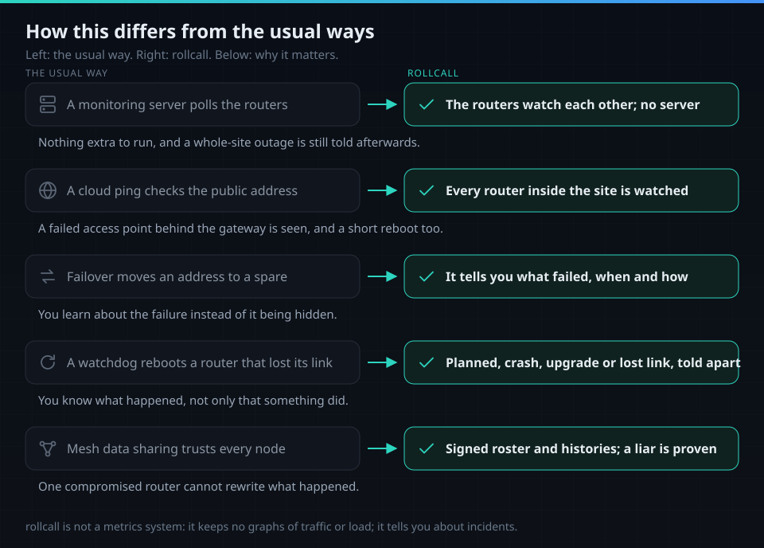
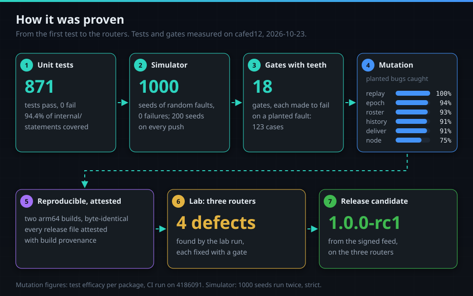

<div align="center">


# rollcall

The routers of one OpenWrt site exchange signed heartbeats and keep a signed roster and history.
When one goes down, reboots, upgrades or loses the internet, a router that is still online tells
your Telegram chat, once per incident.

[](https://github.com/TAIPANBOX/rollcall/actions/workflows/ci.yml)


</div>


**Release candidate [1.0.0-rc1](https://github.com/TAIPANBOX/rollcall/releases/tag/v1.0.0-rc1)**, from
a signed apk feed for OpenWrt 25.12. The final 1.0.0 follows a longer run on routers.

## The problem

A router that dies cannot report its own death. A site often has several routers: a gateway,
access points, mesh nodes. When one of them fails, the owner finds out late, from someone else.

## What it does

- **Runs on the routers themselves**: no server, no cloud service besides the chat. [How](docs/how-it-works.md)
- **The router still online tells you**, and another takes over when the sender is down. [Who sends](docs/how-it-works.md#who-sends)
- **One message per incident**: start and end merged, late records absorbed, acknowledgements spread with the heartbeats. [One incident](docs/how-it-works.md#one-incident-one-message)
- **Says what happened**: a planned reboot, a crash or power cut, an upgrade with old and new version, a lost link while up, the internet or WAN down. [Kinds](docs/how-it-works.md#what-kind-of-incident-it-was)
- **Tells you after a total outage**, with start, end and length. [After an outage](docs/how-it-works.md#when-nobody-could-reach-telegram)
- **No false alarm from one router's cut-off view**: others are asked before a router is called silent. [Asking first](docs/how-it-works.md#noticing-a-silent-router)
- **Trusts no single router**: a signed roster, admin, backup and recovery code, keys bound to the roster, signed histories held by every router. [Security](docs/security.md)
- **Its own sandbox**: its own seccomp filter, no capabilities, no root-only configuration read. [Sandbox](docs/security.md#the-sandbox)

What leaves the site: the site name, router names, event types, times and OpenWrt versions.
rollcall never sends links and never asks you to do anything; a message from the bot that does is
not from rollcall.

## How this differs from the usual ways



<details>
<summary>The same as a table</summary>

| The usual way | rollcall | Why it matters |
|---|---|---|
| A monitoring server polls the routers: one more machine, down with the site, sees only reachable or not | The routers watch each other and the one still online reports; no server | Nothing extra to run, and a whole-site outage is still told afterwards with its span |
| A cloud ping checks the public address | Every router inside the site is watched, access points and mesh nodes included | A failed access point behind the gateway is seen, and so is a short reboot |
| A failover protocol moves an address to a spare device | rollcall tells you, and says why | You learn about the failure instead of it being hidden |
| A watchdog reboots a router that lost its connection | rollcall reports, and tells a planned reboot from a crash, an upgrade and a lost link | You know what happened, not only that something did |
| Tools that share data between mesh nodes trust every node | The roster and every router's history are signed; a router that shows two histories is proven | One compromised router cannot rewrite what happened |
</details>

## How it works


- **Heartbeats** every 5 s over the LAN, sealed and signed; a router silent for 30 s is noticed.
- **Signed records**: the roster, and one history chain per router, copied to every router.
- **One sender**, chosen by the same rule on every router: no server, no vote.
- **One line per incident**, oldest first, plain text.


Every step, with a drawing for each: [docs/how-it-works.md](docs/how-it-works.md).

## Measured


1.0.0-rc1 from the signed feed on three routers, 2026-10-23. How each figure was taken:
[docs/measured.md](docs/measured.md).

## Next to hermes-openwrt


[hermes-openwrt](https://github.com/TAIPANBOX/hermes-openwrt) is an AI agent as an OpenWrt service:
you ask it to look at or change a router. rollcall tells you, without being asked, when a router of
the site goes down. Both ran on the same Flint 2 through two reboots. Each needs its own Telegram
bot.

## Install


OpenWrt 25.12 with apk on each router, and a bot token from @BotFather that no other program
uses. Only `aarch64_cortex-a53` has run on a router; the other targets build and pass the tests.
For an AI agent, with a check after every step: [docs/agent-install.md](docs/agent-install.md).

**1. Trust the feed** on every router. The sum must be
`1dd696c7afce0464688a5106229723f60c8cfb9bd2f6ec296ee5fec24f57ff39`; if not, delete the file and
stop. apk then checks every package and the index against this key, with no `--allow-untrusted`
([docs/feed.md](docs/feed.md)).

```sh
wget -O /etc/apk/keys/rollcall.pem https://taipanbox.github.io/rollcall/rollcall.pem
sha256sum /etc/apk/keys/rollcall.pem
echo "https://taipanbox.github.io/rollcall/25.12/$(cat /etc/apk/arch)/packages.adb" >> /etc/apk/repositories.d/customfeeds.list
```

**2. Install** on every router. It pulls in `procd-ujail`, `procd-seccomp` and `ca-bundle`; the
service is enabled, not started. `luci-app-rollcall` is optional and pulls in `luci-base`.

```sh
apk update && apk add rollcall
```

**3. Create the group**, in an SSH session on the first router. `init` prints the recovery code
once: write it on paper and keep it offline; it is the only way back if both admin routers are
lost. Messages start with the site name (`home`, or `option site` in `/etc/config/rollcall`).

```sh
uci set rollcall.main.sender='1' && uci commit rollcall   # on every router that will send
rollcall init --name gateway
/etc/init.d/rollcall start
```

**4. Add the others.** `rollcall invite` on the first router prints a join code, good once for 10
minutes. `join` reads it from standard input, never from its command line, where any process
could read it.

```sh
/etc/init.d/rollcall start
rollcall join --name ap-office        # paste the code when asked
```

**5. Roles**, on the first router: a backup admin, and the routers that may send.

```sh
rollcall roles backup -- ap-office
rollcall roles sender -- gateway
```

**6. The bot token**, for each sender, from a file on your machine over standard input;
`set-token` reads it from its environment, never from an argument.

```sh
ssh root@gateway 'IFS= read -r TELEGRAM_ROLLCALL_TOKEN && export TELEGRAM_ROLLCALL_TOKEN && rollcall set-token' < token.txt
```

**7. Bind the chat.** `rollcall bind-telegram` on the sender prints a code; send exactly that code
to your bot in a private chat within 10 minutes. Other chats are ignored. **8. Check:**
`rollcall status` lists the members, the sender and the sandbox, and
`grep -E 'NoNewPrivs|Seccomp|^Uid' /proc/$(pidof rollcalld)/status` shows `NoNewPrivs: 1`,
`Seccomp: 2` and uid 1660.

<details>
<summary>All commands, building it yourself, removing it</summary>

| Command | Where | What it does |
|---|---|---|
| `rollcall init` | the first router | creates the group; prints the recovery code once |
| `rollcall invite` | an admin | opens a join window for 10 minutes and prints the join code |
| `rollcall join` | a new router | joins with the code, read from standard input |
| `rollcall roles <role> -- <router>` | an admin | `sender`, `primary`, `backup` or `none` |
| `rollcall remove -- <router>` | an admin | removes a router; the group key rotates |
| `rollcall rotate` | an admin | a new group key now |
| `rollcall set-token` | a sender | stores the bot token from `TELEGRAM_ROLLCALL_TOKEN` |
| `rollcall bind-telegram` | a sender | prints the code that binds the chat |
| `rollcall admin takeover` | the backup admin | takes over when the primary is gone |
| `rollcall admin recover` | any router | the recovery code, read from standard input |
| `rollcall status` | any router | members, sender, incidents, sandbox; `--json` for scripts |

`rollcall help` lists every command and option. To build the packages yourself:
`make apk luci VERSION=<version>` (Go 1.27 and Docker). To remove rollcall:

```sh
apk del luci-app-rollcall rollcall    # only rollcall if the LuCI app is not installed
rm -rf /etc/rollcall /var/run/rollcall /var/run/rollcalld /etc/config/rollcall*
sed -i '/^rollcall:/d' /etc/passwd /etc/shadow /etc/group
```

`apk del` stops the service and removes its firewall rules. `/etc/rollcall` holds the router's
keys and, on a sender, the bot token. If you remove a sender for good, revoke its token in
@BotFather too.
</details>

## How it was proven



- **Simulator**: virtual routers under random faults; 200 seeds on every push, 1000 clean.
- **Gates with teeth**: 18 gates, each made to fail on a planted copy of its fault.
- **Mutation testing**: bugs planted in the product code, and the share the tests catch.
- **Reproducible and attested**: two arm64 builds byte-identical; every release file attested.
- **A lab run on three routers** found four defects the tests had not; each now has a gate.

Details: [docs/testing.md](docs/testing.md) and [docs/reports/v1-report.md](docs/reports/v1-report.md).

## Not yet

- No final 1.0.0 yet, and no feed for OpenWrt 24.10 (opkg).
- Only `aarch64_cortex-a53` on a router; MIPS has not run anywhere, OpenWrt 24.10 not on a router.
- A mesh, separate LANs with their own DHCP, and NAT: only in the simulator so far.
- sysupgrade and a pulled power cord: not run yet.
- Flash writes and wear over days, and network bytes: the long run started on 2026-10-23 will
  measure them.
- The LuCI pages on a router: installed, not used yet.

## Documents

| | |
|---|---|
| [docs/how-it-works.md](docs/how-it-works.md) | heartbeats, the kind of incident, one message, who sends, clocks |
| [docs/security.md](docs/security.md) | threats, the roster and admins, signed history, keys, sandbox, feed |
| [docs/testing.md](docs/testing.md) | scenarios, simulator, gates, mutation, builds, the lab run |
| [docs/measured.md](docs/measured.md) | what ran on routers and in CI, and what it printed |
| [docs/agent-install.md](docs/agent-install.md) | the install as an AI agent runs it, with a check after each step |
| [docs/feed.md](docs/feed.md) | the signed apk feed: the key, how a release reaches it |
| [docs/superpowers/specs](docs/superpowers/specs/) | the design and the security architecture |
| [docs/lab/runbook.md](docs/lab/runbook.md) | the lab runbook for the three test routers |
| [packaging/README.md](packaging/README.md) | what the package installs, the filter, the jail, the snapshot |
| [SECURITY.md](SECURITY.md) · [CONTRIBUTING.md](CONTRIBUTING.md) | reporting a vulnerability, changing the code |
