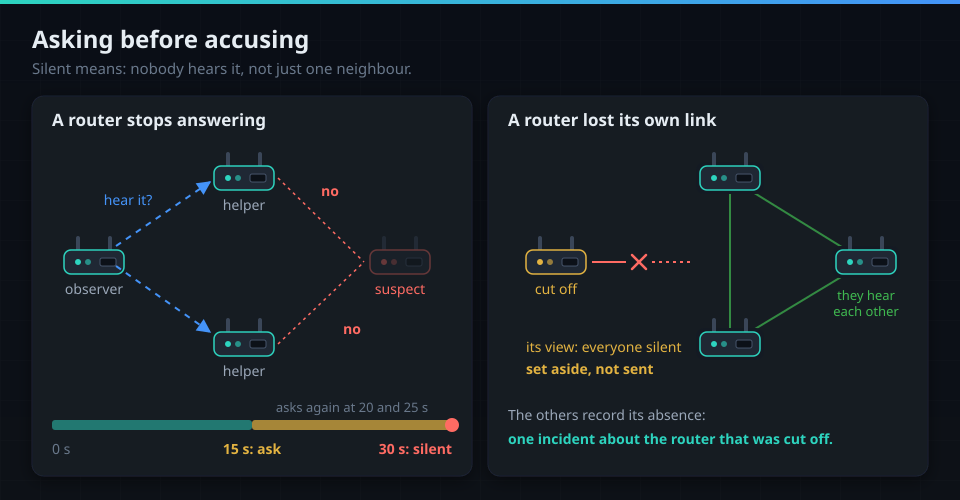
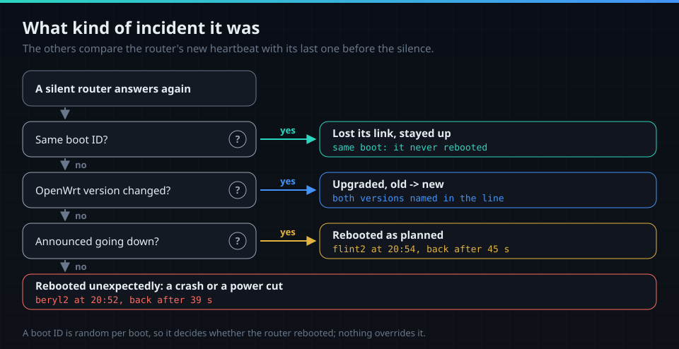
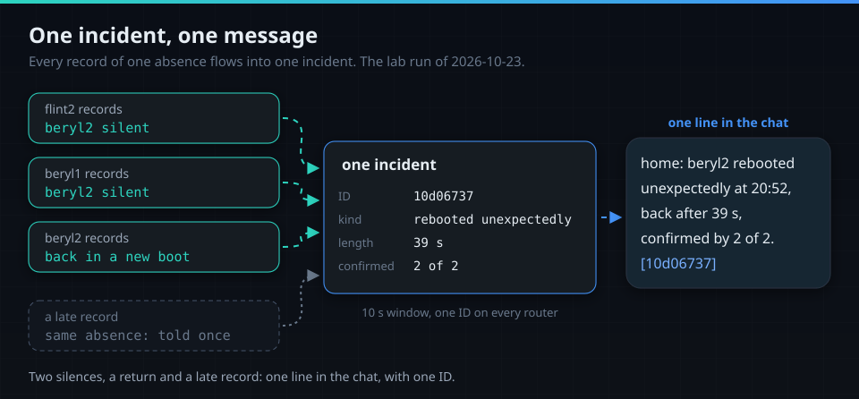
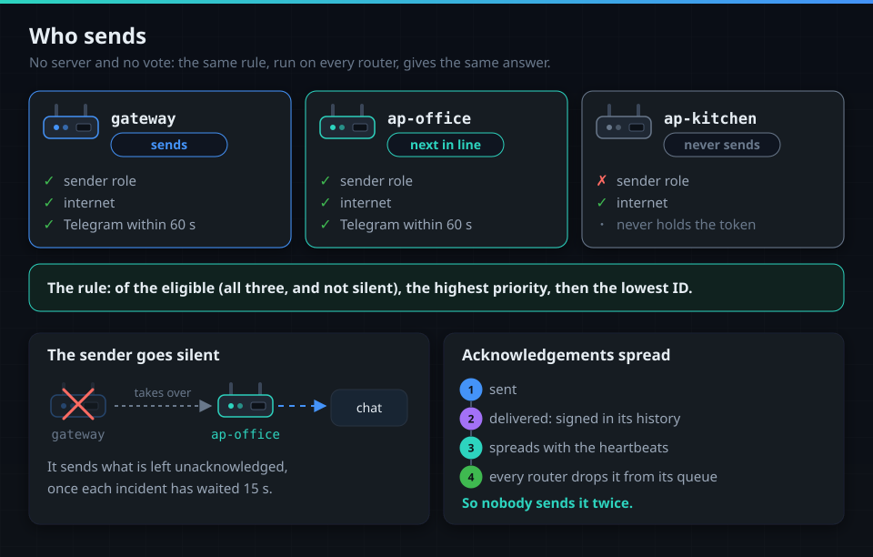
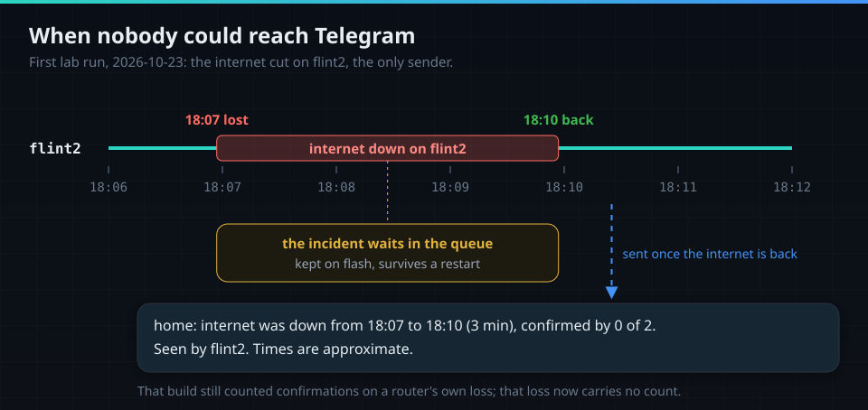
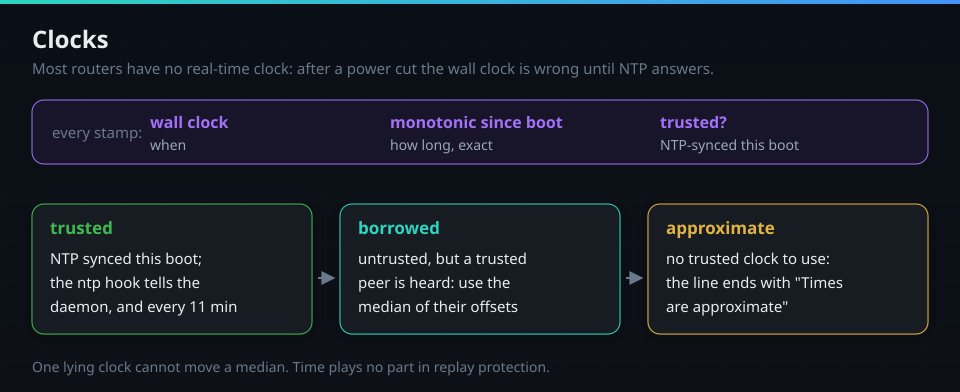

# How rollcall works

The routers of one site watch each other over the LAN, keep signed records, and one of them tells
the chat. Everything here describes the code of 1.0.0-rc1; what ran on routers is in
[measured.md](measured.md), the full design in [superpowers/specs](superpowers/specs/).

## Noticing a silent router

- **Heartbeats**: one UDP packet on port 7432 to each peer every 5 s, sealed with the group key and
  signed. It carries the boot ID, versions, WAN, internet and Telegram state, clock trust, and the
  head of the sender's history.
- **Suspect at 15 s, silent at 30 s.** The silence is stamped when the router was last heard.
- **Ask first.** At 15, 20 and 25 s up to two helpers are asked. A helper answers with the
  suspect's own signed heartbeat, so its word alone saves nobody.
- **Cut off is not an accusation.** A router that lost its own link sees everyone go silent; the
  others recorded *its* absence, and its view is set aside. With only two routers, both views stay.
- **Internet**: every 10 s a TCP connection to port 443 of 1.1.1.1 and 8.8.8.8 (configurable); any
  answer counts, three failed rounds mean lost. **WAN**: hotplug events through the CLI, never ubus.
- **DNS**: in the same rounds, one query for `openwrt.org` (option `dns_name`) to each DNS server
  the uplink names in `/tmp/resolv.conf.d/resolv.conf.auto`, past dnsmasq's cache (or to the
  servers of `list dns_server`). Any answer counts, "no such name" too; three failed rounds mean
  lost. A round counts only while the internet probe gets through, so a lost internet is told as
  that, never as DNS as well. Without servers the probe judges nothing and the log says so once;
  `option dns_probe '0'` turns it off.

## What kind of incident it was

- **The boot ID decides.** It is random per boot; the same boot ID means the router stayed up.
- **Planned or not.** At a clean shutdown the daemon sends "going down" three times, to the
  multicast group and to every known peer, so one lost packet cannot turn it into a crash.
- **Upgrade.** A new OpenWrt version after a new boot is an upgrade, with both versions.
- **Fast reboots count.** A heartbeat with a new boot ID is a reboot even without a 30 s silence.

## One incident, one message

- **One absence, one incident**: the silence, the return and the router's own account, however long
  it was away. The window is 10 s from the first event.
- **One router's link changes, 30 s apart at most, one message** (`@decided 2026-10-30`): its WAN,
  internet and DNS losses at the start of an outage in one line ("WAN and internet went down at
  14:34"), the returns at its end in one line, and a link that keeps dropping in one line with
  the count ("WAN went down 3 times, 1 min 7 s in all"). The first alert comes later for it
  (`@decided 2026-10-30`): about 40 to 45 s later for a WAN cut and about 20 s later for an
  internet loss alone, since the internet probe records its loss about 20 s after the WAN went
  down and the chain then waits its 30 s (replayed lab cells: 52 to 57 s after the first
  record, against 12 s and 37 s with a 10 s window). A loss its probe records later still joins the outage it
  belongs to. A link that never stops dropping is told at the latest 60 s after its first record,
  while it still flaps ("WAN keeps dropping since 09:01: down 6 times so far"); its end then tells
  the whole outage with every drop.
- **A cause and its effects**: the main router reboots and the access points lose the internet:
  one message about the main router.
- **The whole site**: every router loses the internet, or the power: one message naming them all.
- **Start and end together**: an outage is held back while its end is about to join it.
- **Each router's own outage**: a return ends only the loss of the router that came back; two routers
  back within seconds give one message, from the first loss to the last return. When some are back
  and others still down, the message says which.
- **Late records** of the same type about the same router are told already: absorbed.
- **One ID**: the tag is the first 8 digits of the incident ID, which every router computes alike.

The two reboots of the lab run, as they happened:

## Who sends

- **Eligible**: the sender role, internet, a successful Telegram call within 60 s, not silent.
- **Chosen**: the highest priority, then the lowest member ID. No server, no vote.
- **Takeover**: the sender goes silent, the rule names the next one, which sends what is left once
  it has waited 15 s.
- **Acknowledged**: the sender signs "delivered" into its history; it spreads with the heartbeats.
- **At least once**: after a split two routers may send one incident; the tag shows the copy.
- **Paced**: oldest first, at most one message per second per chat.
- **Logged**: each message sent leaves `told the chat about incident <tag>` in the log (daemon.info);
  failed sends leave one daemon.err line per reason, not one per attempt.
- **Quiet hours**: with `option quiet_hours '23:00-07:00'` a message sent within that span makes no
  sound. It reaches the chat at once, with the same text; Telegram gets `disable_notification`
  (no sound; whether the phone still vibrates is up to the phone and its Telegram app), ntfy
  priority 2 (low: no sound, no vibration). The router's time zone decides, the one the
  messages show, and so does the moment of sending: an incident of 22:58 sent at 23:00 is quiet.
  The start is included and the end is not, so 23:00:00 is quiet and 07:00:00 rings. Nothing waits
  for the morning. Off unless set; a value that is not `HH:MM-HH:MM` stops the daemon with the
  reason, as any other wrong option does.

## When nobody could reach Telegram

- Every router queues every incident it learns of; nothing is sent while nobody can send.
- The queue is kept on flash, so an incident held during an outage survives a restart.
- The first router that can send again sends it, with start, end and length.
- An incident that ended more than a day before it could be sent is kept, not sent.
- At 1000 queued incidents the newest are refused, and the chat gets one notice.

## Clocks

- A length within one boot comes from the monotonic clock: exact, whatever the wall clock did.
- **Trusted** means NTP-synced in this boot; the ntp hotplug hook tells the daemon when it syncs,
  steps, and every 11 minutes.
- **Borrowed**: an untrusted router stamps with the median offset of its trusted peers.
- **Approximate**: otherwise the line says so. In the first lab run two lines did; the periodic ntp
  event fixed it, and the evening's lines carry no note.

## Compared with the usual ways

- **A monitoring server polls the routers.** One more machine, and it goes down with the site when
  it sits in it. rollcall has no server; the 3-minute internet cut on flint2 was told once it was
  back: "internet was down from 18:07 to 18:10 (3 min)".
- **A cloud ping checks the public address.** It sees nothing behind the gateway. rollcall watches
  every router, and a reboot is seen by its new boot ID even when it is shorter than a ping
  interval.
- **A failover protocol moves an address to a spare device.** The failure stays hidden. rollcall
  tells you which router failed, when, for how long and how.
- **A watchdog reboots a router that lost its connection.** You learn nothing. rollcall told
  beryl2's forced 39 s reboot as "rebooted unexpectedly" and flint2's clean one as "rebooted as
  planned"; an upgrade names both versions.
- **Tools that share data between mesh nodes trust every node.** In rollcall the roster and every
  router's history are signed, and a router that shows two histories is caught with proof
  ([security.md](security.md#history-a-signed-chain-per-router)).
- rollcall is not a metrics system: it keeps no graphs of traffic or load; it tells you about
  incidents.

## Where it is in the code

| Part | Package |
|---|---|
| heartbeats, suspicion, helpers, clock offsets | `internal/member` |
| the kind of incident, incidents | `internal/events` |
| the cut-off rule, late records, holding back | `internal/node` |
| who sends | `internal/elect` |
| queue, pacing, acknowledgements, message text | `internal/deliver` |
| stamps and lengths | `internal/clock` |
| internet probes | `internal/probe` |
