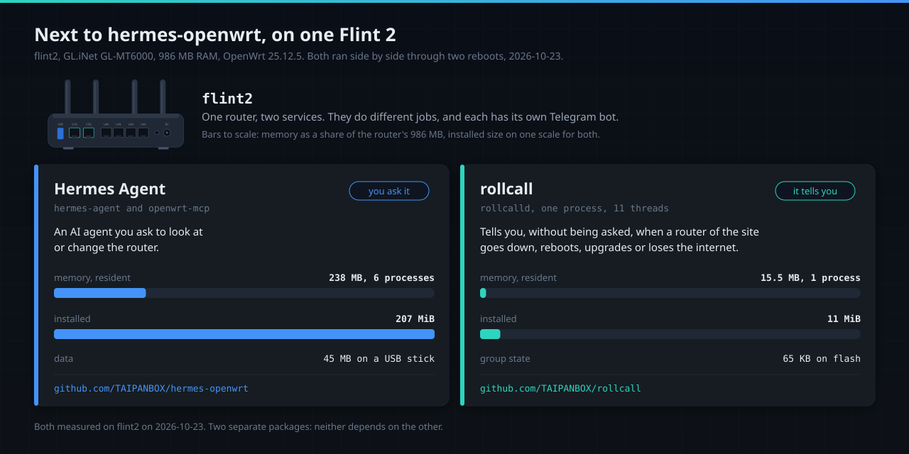
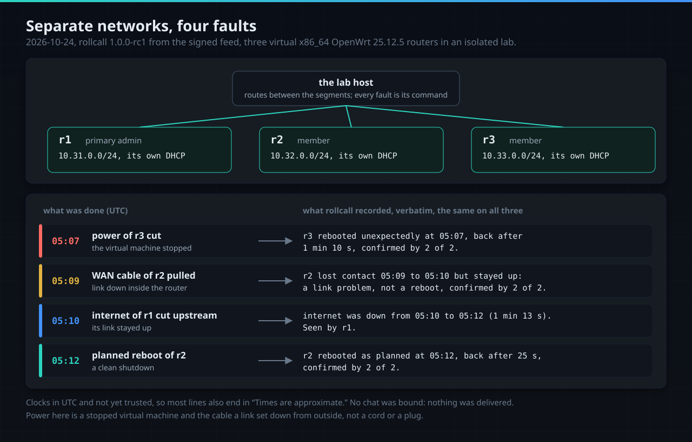

# Measured

What was run, where and when, and what it printed. A claim that is not in this file has not been
run; the [list at the end](#not-yet) names what is still open.

## The lab run, 2026-10-23

Three routers on vanilla **OpenWrt 25.12.5**, all `aarch64_cortex-a53`: a GL.iNet Flint 2 named
`flint2` and two Beryl AX named `beryl1` and `beryl2`. The packages came from the CI job
`lab-packages` (version `0.0.0-rc67`, commit `4186091`) and were installed by hand. On that day all
three routers sat on one LAN segment, with their WAN ports unused and their radios off.

Roles: `flint2` primary admin and sender, `beryl1` backup admin, `beryl2` an ordinary member.

| Step | What happened |
|---|---|
| install | `apk add` of `rollcall` and `luci-app-rollcall` on all three; every package file owned by root (checked on the reinstall after fix 1 below) |
| `rollcall init` on flint2 | group `home` created; the recovery code printed once, kept in a private file for the run and deleted at its end |
| `rollcall invite` and `rollcall join`, twice | beryl1 and beryl2 joined; the join code was piped from one router to the other and never printed; the group key rotated at the second join |
| `rollcall roles` | beryl1 backup admin, flint2 sender |
| `rollcall set-token` on flint2 | the token went in through the environment; afterwards `logread` held 0 token-shaped strings |
| `rollcall bind-telegram` | the chat was bound with one code sent from a phone; the four roster announcements held while no chat was bound arrived together |
| internet cut on flint2 | default route removed at 18:06:57, put back at 18:09:57: one message |
| forced reboot of beryl2, no clean shutdown | one message, back after 44 s |
| clean reboot of flint2 at 18:16:16 | one message at 18:17, back after 45 s |
| removal | `apk del`, then the state directory, the configuration, the user and the group: no file left, no firewall rule, no user, port 7432 closed |

### The sandbox, read from `/proc` on each router


The three routers printed the same values:

- `NoNewPrivs: 1`, `Seccomp: 2`, `Seccomp_filters: 1`. The one filter is the daemon's own: procd
  installs none.
- `Seccomp: 2` on every thread: 10 threads on flint2, 8 on each Beryl AX.
- The log line `seccomp filter installed on every thread: 74 system calls of linux/arm64 allowed,
  any other ends the process`. The profile the package ships lists the same 74.
- `Uid` and `Gid` 1660, the `rollcall` account.
- `CapInh`, `CapPrm`, `CapEff` and `CapAmb` all 0. `CapBnd` was still the full set
  (`000001ffffffffff`); see [Not yet](#not-yet).
- The jail's root holds `dev etc proc sys tmp usr var`, not the router's own root.
- `listening on port 7432 on br-lan; SO_BINDTODEVICE applied: true`.

### The chat


The lines as the chat received them, one per incident:

```text
home: internet was down from 18:07 to 18:10 (3 min), confirmed by 0 of 2. Seen by flint2. Times are approximate.
home: beryl2 rebooted unexpectedly at 18:11, back after 44 s, confirmed by 0 of 2. Times are approximate.
home: flint2 rebooted as planned at 18:16, back after 45 s, confirmed by 1 of 2.
```

What they show, and what they do not:

- **One message per incident.** The start of the internet outage was merged into the incident and
  not sent on its own. The forced reboot was one message, not "stopped answering" and then "back".
- **A planned reboot and a crash read differently.** flint2 announced its shutdown; beryl2 did not.
- **"Times are approximate"** on the first two lines: the daemons had started after the router
  clocks were set, and nothing told them so. After flint2's reboot the clock event came with the
  boot, and its line carries no such note.
- **"confirmed by 0 of 2"** on beryl2's reboot read as if no router confirmed it, although flint2
  and beryl1 both saw beryl2 go silent: the count took only signed statements about the earliest
  record, and those are made only on a trusted clock. After the lab run the count was changed to
  the routers that recorded the absence or agreed with it when the message is made, and an
  internet or WAN loss, which is one router's own event, carries no count. In the tests the lab's
  lines now read "confirmed by 2 of 2"; this has not run on the routers yet.

The wording is that day's. It may change before a release.

### Found during the run and fixed before its end

Each fix has a test or a gate that failed on the old code.

1. **Package files owned by nobody.** apk-tools 3.0.7 names the owners of a package from the
   staged tree, and the CI runner's uid was unknown in the build image, so every file installed as
   `nobody:nogroup`. `scripts/mkapk.sh` now packs a root-owned copy and reads the package back; the
   gate `TestPackagesOwnedByRoot` checks every entry, and CI plants a nobody-owned file to prove the
   gate fails on it.
2. **Root-only configuration.** `/etc/config/network` and `system` are mode 0600 root on 25.12.5
   and can hold PPPoE passwords and WireGuard keys. The daemon may not read them, so root now writes
   a snapshot of the few facts it needs (`rollcall snapshot`), and the daemon reads only that.
3. **A directory under `/tmp` prepared as root.** The run directory moved to `/var/run`, and a gate
   refuses `mkdir`, `chown` or `chmod` under `/tmp` in the init script.
4. **procd cannot filter a static program.** procd applies a seccomp profile through
   `LD_PRELOAD`, which a statically linked Go binary never loads: the daemon read `Seccomp: 0` and
   refused to listen. It now installs its own filter at start ([packaging/README.md](../packaging/README.md#seccomp-the-daemon-installs-its-own-filter)).

### Two traps for whoever runs the steps

- A rollback timer started with `nohup ... &` over SSH died with the session, and the route stayed
  removed for about 20 s with no timer behind it. A timer started with `start-stop-daemon -b`
  survived and was checked from a new session.
- A helper function that reused a shell variable sent one `join` to the wrong router. That router
  refused it, as it should.

Skipped that day: sysupgrade, a mesh, NAT, and the replay and flood checks from a laptop on the LAN.
A baseline of the flash write counters was taken at 18:18; no soak followed, so there is no figure.

## Release candidate 1.0.0-rc1 on the routers, 2026-10-23 evening

The same three routers, now from the signed feed of the release candidate.

- **Install from the feed.** On each router: the key, its SHA-256 compared
  (`1dd696c7afce0464688a5106229723f60c8cfb9bd2f6ec296ee5fec24f57ff39`), the feed line, then
  `apk add rollcall`. apk installed `rollcall-1.0.0_rc1-r1` with no `--allow-untrusted`, and every
  file of the package was owned by root.
- **The sandbox**, from `/proc` on each router: uid 1660, `NoNewPrivs: 1`, `Seccomp: 2` on every
  thread (9, 8 and 8 threads), and every capability set empty, the bounding set included
  (`CapBnd: 0000000000000000`). It was the same after each reboot below.
- **The chat**, verbatim, in the order the lines arrived:

```text
home: the group changed: beryl1 added (by flint2).
home: the group changed: beryl2 added (by flint2).
home: the group changed: beryl1 is now the backup admin (by flint2).
home: the group changed: flint2 is now a sender (by flint2).
home: beryl2 rebooted unexpectedly at 20:52, back after 39 s, confirmed by 2 of 2.
home: flint2 rebooted as planned at 20:54, back after 45 s, confirmed by 2 of 2.
```

  The four announcements were held until the chat was bound and then went out in the order of the
  changes, each naming the role. The two reboots (a forced one without a clean shutdown, and a clean
  one) each gave one line, counted by both routers that saw it, and with the routers' clocks
  trusted: the daemons had started after the clocks synced and learned of it from ntp's periodic
  event.
- **The two reboots, timed.** beryl2 was forced to reboot at 20:52:24 with no clean shutdown, and
  flint2 was rebooted cleanly at 20:53:57 (the times the commands were sent). The lines give 39 s
  and 45 s; the chat shows them arriving at 20:53 and 20:55. flint2 is the only sender: its first
  line went out before its own reboot, and the line about that reboot once it was back.



- **Resources at the start of the long run** (20:45): 12.1 to 15.3 MB resident per daemon, 8 to 11
  threads, 43 to 60 KB of state.

### Footprint per router, 21:57



| Router | Role | RAM | Resident (peak) | Threads | CPU, one core | State on flash |
|---|---|---|---|---|---|---|
| `flint2`, Flint 2 (GL-MT6000) | primary admin, sender | 986 MB | 15.5 MB (15.7) | 11 | 0.15% | 65 KB |
| `beryl1`, Beryl AX (GL-MT3000) | backup admin | 485 MB | 12.8 MB (13.7) | 9 | 0.14% | 80 KB |
| `beryl2`, Beryl AX (GL-MT3000) | member | 485 MB | 12.6 MB (13.0) | 8 | 0.14% | 76 KB |

How each column was taken, over SSH on each router:

- **RAM**: `MemTotal` from `/proc/meminfo`.
- **Resident and peak**: `VmRSS` and `VmHWM` from `/proc/$(pidof rollcalld)/status`, in kB, divided
  by 1000. **Threads**: the `Threads:` line of the same file.
- **CPU**: `utime` plus `stime` from `/proc/<pid>/stat`, sampled twice 120 s apart, against
  `/proc/uptime`. flint2 used 18 ticks of 10 ms in 120.6 s, each Beryl AX 17: 0.15% and 0.14% of one
  core.
- **State on flash**: `du -k /etc/rollcall`, the group's keys, roster and history.

The package, `rollcall-1.0.0_rc1-r1` for `aarch64_cortex-a53`: 4,865,188 bytes to download (4.9 MB),
11 MiB installed. The daemon `rollcalld` is 8,192,160 bytes and the `rollcall` CLI 3,866,784 bytes,
the same on all three routers. `luci-app-rollcall` is 8,716 bytes.

Not measured: flash writes per hour (a two-minute window could not separate rollcall's writes from
the rest of the system; the long run will), network bytes, and power.

### Next to hermes-openwrt on flint2



flint2 also runs [hermes-openwrt](https://github.com/TAIPANBOX/hermes-openwrt), an AI agent packaged
as an OpenWrt service. The same day, Hermes Agent with openwrt-mcp held 238 MB resident in 6
processes; `hermes-agent` has an installed size of 207 MiB, and its data took 45 MB on a USB stick.
rollcall beside it: 15.5 MB and 11 MiB. The two ran side by side through two reboots of flint2.
They are separate packages, and neither depends on the other. Each needs its own Telegram bot: a
second program polling the same bot gets in the way of rollcall's chat binding.

## Virtual routers in separate networks, 2026-10-24

Three virtual x86_64 routers on OpenWrt 25.12.5 (QEMU/KVM) in an isolated lab, named `r1`, `r2`
and `r3`. Each sat in its own segment (`10.31.0.0/24`, `10.32.0.0/24`, `10.33.0.0/24`) with its
own DHCP, and the lab host routed between them. `rollcall-1.0.0_rc1-r1` came from the signed feed,
its key checked against the same SHA-256. `r1` created the group and `r2` and `r3` joined, each
reaching the others in the `wan` zone through static peers, as a router in another network does.



- **The four faults**, and the line each gave, verbatim from `rollcall status` on `r1`; `r2` and
  `r3` hold the same four lines. The routers' clocks were in UTC.

```text
home: r3 rebooted unexpectedly at 05:07, back after 1 min 10 s, confirmed by 2 of 2. Times are approximate.
home: r2 lost contact 05:09 to 05:10 but stayed up: a link problem, not a reboot, confirmed by 2 of 2.
home: internet was down from 05:10 to 05:12 (1 min 13 s). Seen by r1. Times are approximate.
home: r2 rebooted as planned at 05:12, back after 25 s, confirmed by 2 of 2. Times are approximate.
```

  - **Power of `r3` cut**, by stopping its virtual machine: an unexpected reboot, counted by both
    other routers.
  - **WAN cable of `r2` pulled**, the link set down from outside, so the router saw carrier 0: told
    apart from a reboot and counted by both others, who also recorded "internet was down from 05:09
    to 05:10 (54 s). Seen by r2." While cut off, `r2` saw `r1` and `r3` go silent and set that aside,
    as a router that lost its own link does; the other two lists do not carry it.
  - **Internet of `r1` cut upstream**, its link up: an internet outage seen by `r1`, and no line that
    `r1` stopped answering, because it still answered.
  - **A planned reboot of `r2`.**
- **What this run does not show.** No chat was bound, so nothing was delivered. Each incident is
  listed with the record of its start and the line that closes it; when the sender delivers, a
  start whose incident has already closed folds into the closing line, and on the routers on
  2026-10-23 one outage gave one chat message. The clocks were not yet trusted, hence "Times are
  approximate". Power here is a stopped virtual machine, not a cord, and the cable a link set down
  from outside the router.
- **Found: a restart kept the old firewall rules.** With `peer_zone` set to `wan` and the static
  peers added, the peers' packets were dropped and the joins refused until
  `/etc/init.d/rollcall firewall` ran and the firewall reloaded; `r3` joined right after. Only
  `reload_service` rebuilt the rules, and a restart, the usual step after a change, never ran it.
  Fixed: every start brings the rules in line with `peer_zone`, `port` and the static peers, and
  reloads the firewall only when they changed (gate `TestInitScriptHardening`, test
  `TestFirewallFollowsTheConfiguration`). Run against the uci and busybox of OpenWrt 25.12.6 in a
  container, the firewall reloaded at the first start, at a change of zone and at a change of port,
  and not when nothing had changed. On 1.0.0-rc1, after changing `peer_zone`, `port` or `peer`, run
  `/etc/init.d/rollcall reload` instead of a restart.

## Faults on a test uplink, 2026-10-30

The same three routers, each now behind a WAN of its own: `flint2` and `beryl2` take their uplink
from a fourth router kept as a test uplink, which cuts, flaps, delays or drops their traffic on
command; `beryl1` stays on the home uplink. A host on the LAN ran the cells one after another,
sampled the routers every 15 to 30 s, and kept their logs and `rollcall status --json` from before
and after each cell. Senders: `flint2`, then `beryl1`. Times are London time.

**rc92 (`e3f542e`), 17 cells in the day.**

- **Degraded links**: 300 ms of delay with 50 ms of jitter, 10 % and 30 % loss, 256 kbit/s, and a
  mix like a mobile link, 5 minutes each on both uplinks. No incident, no message, no change of
  sender.
- **All traffic dropped with the link up, or the internet cut behind the uplink**: the incident
  opened 4 to 8 s in, its message came 37 to 60 s after the cut, and the end 16 to 30 s after the
  return.
- **Both uplinks down for 2 minutes, and the sender's internet cut**: `beryl1` took over sending
  within 30 to 60 s and gave it back 30 to 90 s after the return.
- **A two-hour WAN loss**: "2 h" in both closing messages.
- **Found**: one outage gave 3 to 6 messages (a WAN that flapped ten times: 6), and a DNS cut on
  the uplink, with TCP still passing, gave none. Both were fixed in
  [#7](https://github.com/TAIPANBOX/rollcall/pull/7): one router's link changes within 30 s are one
  incident, and a DNS probe asks the uplink's servers.

**rc93 (`a82de7c`, #7 with the quiet hours of #8), 14 cells at night.**

- **One outage, two messages**: the WAN that flapped ten times 2 (6 on rc92), both uplinks down 2
  (3 on rc92), a WAN lost for 20 minutes 2.
- **A DNS cut of 5 minutes**, on either uplink: "DNS stopped answering at ..." 55 to 70 s in, and
  "DNS was down from ... (5 min 14 s to 5 min 17 s). Only name lookups failed." 37 to 42 s after the
  return.
- **10 % and 30 % loss**: no incident but one, 32 s of DNS loss on `flint2`'s uplink at 30 %, when
  three rounds in a row got no answer from its resolver.
- **`rollcall restart` while the internet was cut**: one incident, two messages, "Times are
  approximate"; the restarted daemon's second record of the loss joined it.
- **Quiet hours** `22:00-08:00`: all 19 messages of the night went out within them, with
  `disable_notification`. The phone of the chat showed them without a sound, and vibrated:
  Telegram promises a notification without a sound and leaves vibration to the phone and its app.
- **Found: a later outage stretched back to pieces rc92 had kept.** The end of the both-uplinks cell
  was told as "WAN was down from 12:06 to 22:09 (10 h 3 min) ... WAN went down 3 times on beryl2,
  10 h 3 min in all", for an outage of 2 min 13 s. rc92 had kept the day's flap in pieces, three of
  them a return and the drop after it, and the return that ended the flap in another piece; rc93
  restored them from its state file and took their drops for an outage still open. Fixed: a kept
  incident holds an outage open only while its drop is the router's last record of that link among
  the kept incidents (`TestOlderPiecesOfAFlapDoNotStretchALaterOutage`,
  `TestOpenLinksTakeLaterReturns`). No such piece was left in the state files of the three routers
  afterwards.
- **The rerun on rc94** (`647cfcb`, cell R1.5 on 2026-10-31 at 02:40): the end said "WAN and internet
  were down from 02:40 to 02:43 (2 min 30 s)", nothing reaching back. But the start went out twice,
  3 s apart: both internet probes recorded their losses 20 to 30 s after the cut, the chain settled
  past the 60 s ceiling, the ceiling made the start, and the chain then went quiet with both links
  still down and was told again as its own end. Fixed: such a chain has nothing to tell until the
  return (`TestLateLossesPastTheCeilingOneStart`).
- **The flap into an outage on rc96** (`8473828`, cells V3 on 2026-10-31 at 04:39): beryl2's WAN
  cut and restored every 5 s nine times, then 5 s later cut for 3.5 min. The end said "WAN and
  internet were down from 04:39 to 04:45 (5 min 29 s). WAN went down 4 times, 5 min 16 s in all.
  Internet went down 2 times, 5 min 18 s in all". But three messages went out: the flapping at
  04:40:36, "WAN and internet went down at 04:39. WAN went down 4 times. Internet went down 2 times"
  at 04:42:10, and the end at 04:45:33. The internet probe recorded its last loss 20 s late, and once
  it settled it merged with the capped chain into a message of its own, though it brought nothing
  back. Fixed: records that continue a capped chain and bring none of its links back join it with
  no message, and a chain with no link back tells no end of its own, an internet return older than
  its router's last WAN drop counting as none (`TestFlapIntoOutageTwoMessages`, a replay of the
  records flint2 kept).

## CI

Run `39990683889`, the push of commit `4186091` on 2026-10-23. Every job passed:

- **gates**: `gofmt`, `go vet`, `go mod verify`, a build with the release flags, `go test -race`
  with a coverage profile, the 200-seed simulator sweep, the coverage floor, `govulncheck`.
- **reproducible**: two `linux/arm64` builds with separate caches, byte-identical.
- **packaging**: the `x86_64` release set, what the `.ipk` and the `.apk` contain, every entry owned
  by root, and the planted nobody-owned file caught.
- **seccomp**, three legs. `rollcalld` was started with no loader and ran under its own filter on
  every thread: `x86_64` (75 calls), `aarch64_cortex-a53` (74) and `arm_cortex-a7` (87, run on the
  arm64 runner). Each served its control socket, bound UDP and TCP 7432, made a group, ran discovery
  for 30 s and stopped cleanly. Daemons built with one call left out of the list (`prctl`,
  `eventfd2`, `epoll_pwait`, and `futex_time64` on arm) were killed by SIGSYS.

Also on every push: the **simulator sweep**, 200 seeds, each a site of 3 to 5 routers put through
random faults (power cuts, reboots, upgrades, partitions, internet and Telegram outages, packet loss
and delay), with its invariants checked afterwards. 1000 seeds, run twice on a development branch
on 2026-10-23, were all clean then. On `98a14b1`, 2026-10-31, 998 of 1000 were clean: in seeds 241
and 698 one router sent the update of a corrected absence twice, 1 s apart ("r03 rebooted
unexpectedly, back at 09:05."), as the claims about it reached it in two reconciliations (I30); the
200 seeds of CI do not reach either. With that fixed, on `4fed9b0`, 1000 seeds, run twice, were all
clean (`ROLLCALL_SEEDS=1000 go test ./internal/sim/`, 5 min 1 s and 4 min 20 s).

**Gates**: 19 under `internal/gates`. `TestGatesHaveTeeth` plants, for each one, the fault it exists
for and requires the gate to fail, or requires it to pass on clean input. On `524f26a`, 2026-10-24,
all 128 cases passed in the full run below (123 on `cafed12`, before the gate for the firewall rules
at every start).

CI has no MIPS runner. A mutation job (gremlins v0.6.0) runs on manual runs and tags; it reports
scores and does not gate. Run `39990682729` on `4186091`, test efficacy per package: replay 100.00%,
epoch 94.34%, roster 93.33%, history 90.65%, deliver 90.57%, pairing 84.69%, elect 84.62%, sig
80.00%, wire 80.00%, node 75.38%.

## Tests on a workstation

`go test ./... -count=1 -json` on 2026-10-24 at 07:16 BST, commit `524f26a`, Go 1.27.3 on
darwin/arm64: 872 top-level tests passed, 0 failed, 4 skipped, and 923 subtests passed; 31 packages
passed, two have no tests. The four skips: two gates that read what CI prepares
(`ROLLCALL_COVERAGE`, `ROLLCALL_PACKAGES`), the ICMP probe (it needs a raw socket), and one
link-local test that does not apply to macOS's loopback. Earlier runs: 871 and 913 on 2026-10-23 at
22:20 on `cafed12`, 869 and 902 at 19:40 on `b2f9618`, 848 and 867 at 18:44 on `80c38d8`.

Coverage on `524f26a`, every statement of `internal/...` together: 94.4%
(`go test -coverprofile=internal.out ./internal/... && go tool cover -func=internal.out`), as on
`cafed12` and `b2f9618`. On `80c38d8` it was 94.3%, from 90.4% (`internal/node`) to 100% per package. CI over `./...` with
`-race` on `4186091`: 90.3%. On macOS the code that installs the seccomp filter does not run; the
CI legs above run it. The CI gate keeps coverage from falling below `coverage-baseline.txt`, which
holds 90.0 since commit `2f3f314`.

## Not yet

- **Flash wear over days, flash writes per hour, network bytes, power.** Not measured. For the
  flash only baselines were taken; the long run of 1.0.0-rc1 that started at 20:45 will give it.
- **MIPS on hardware**, and every target but `aarch64_cortex-a53` on a router. arm ran in CI only;
  x86_64 ran in CI and in virtual routers (above).
- **OpenWrt 24.10 and the `.ipk`.** Built, never installed on a router.
- **A mesh and NAT, and separate networks on hardware.** Separate networks with their own DHCP,
  routed between them, ran on virtual routers (above). The hardware routers shared one LAN, and a
  mesh and NAT ran in the in-process simulator only.
- **Delivery to the chat from separate networks.** The virtual run bound no chat.
- **sysupgrade.** Not run, so whether a clean shutdown is announced during one is not known.
- **A pulled power cord, and an unplugged WAN cable on hardware.** The hardware lab forced a reboot
  and removed a route instead; the virtual lab stopped a machine and set a link down from outside.
- **Replay and flood from a device on the LAN.** The tools are in `tools/`; unit tests and the
  simulator cover forged and replayed packets, the lab did not run them.
- **The LuCI pages on a router.** The package installed; its pages and its rpcd rules were not used.
- **ICMP probes** (off by default) and the capability they add.
- **A feed for OpenWrt 24.10 (opkg).** It does not exist; the 25.12 apk feed does and ran on the
  routers (above).
