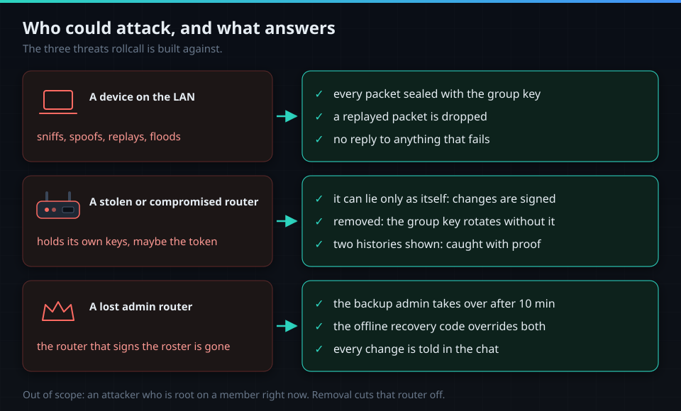
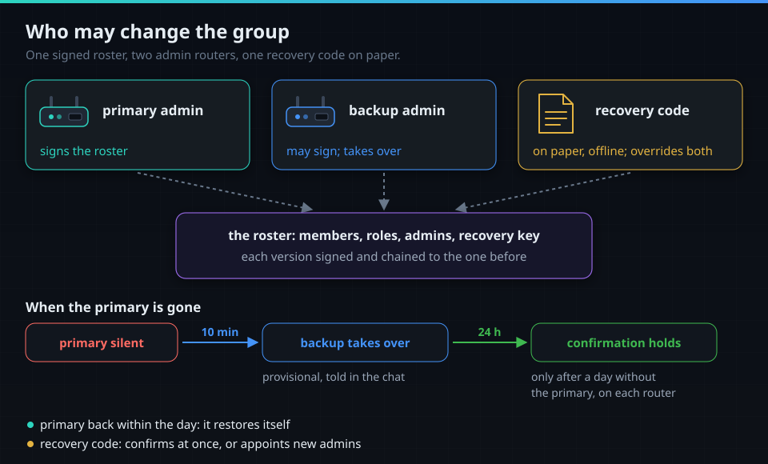
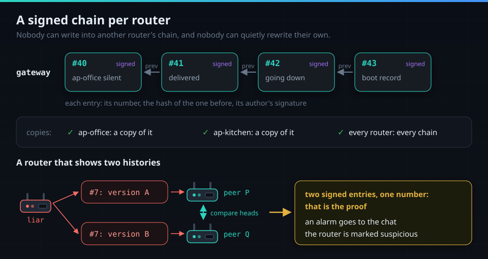
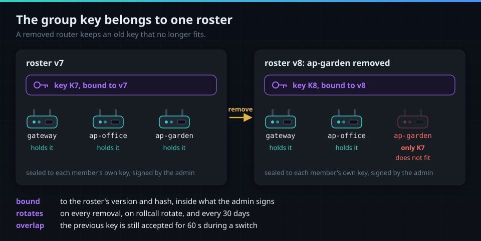

# Security

What rollcall protects, from whom, and how. Each bullet names what holds it: a test, a gate or a
run on routers. The invariants and their gates are listed in [CLAUDE.md](../CLAUDE.md); the full
specification is [superpowers/specs/2026-10-22-rollcall-security.md](superpowers/specs/2026-10-22-rollcall-security.md).
To report a vulnerability: [SECURITY.md](../SECURITY.md).

## Who could attack

- **Every packet is sealed**: XChaCha20-Poly1305 under the current group key, a random 24-byte
  nonce, at most 1200 bytes. A device never paired cannot make one that is accepted.
- **Cheapest check first**: length, version, epoch, seal, replay, roster, signature, fields.
  Anything that fails is dropped and counted, never answered, and never causes a send (test
  `TestUnauthenticatedProducesNothing`).
- **Replays are dropped**: per peer, its boot number, its boot ID and a 64-packet window. Time plays
  no part (test `TestReplayRejectsDuplicate`).
- **Every change is signed** by its author with Ed25519, so a router can lie only as itself.
- **Floods**: no blocking by source address, which a spoofed address could turn against a member;
  reading is rate-bounded, and a burst of failures raises an "under flood" event.
- **Nothing listens on the internet side**: listeners bind only to the interfaces of the peer
  zones, and the firewall rule admits only those zones (test `TestListensOnlyOnGivenIfaces`).

## Who may change the group

- **The roster** lists members, keys, roles, the primary and backup admin and the recovery key.
  Each version is signed and carries the hash of the one before; members take only the next one
  (tests `TestVerifyChain`, `TestVerifyAuthority`).
- **Its shape is fixed**: exactly one primary, at most two admins, exactly one recovery key (test
  `TestRosterShape`).
- **Takeover**: a member accepts the backup as primary only after 10 minutes without hearing the
  primary itself; a primary that returns restores itself (test `TestTakeoverNeedsTenMinutesOfSilence`).
- **Confirmation** by the backup holds only after a day without the primary, counted on each
  member; the recovery code confirms at once (test `TestConfirmationNeedsADay`).
- **After a split** the branch started by the higher authority wins (recovery key, then primary,
  then backup), then the newer version. What the losing branch changed is told in the chat as
  undone, so a person can repeat it.
- **Every change is told** in the chat once, with the router that signed it (test
  `TestRosterChangeAnnouncedOnce`). Removing a router is always a command run by a person.

## History: a signed chain per router

- **Each entry** carries its author's next number, the hash of the entry before and the author's
  signature (tests `TestRejectsForeignSignature`, `TestRejectsBrokenPrev`).
- **Append only**: a correction is a new entry; nothing is rewritten (test `TestAppendOnly`).
- **Copies everywhere**: every router holds the others' chains, so an event outlives the router
  that saw it.
- **Witnesses**: the others record what they saw in their own chains; the chat line counts them.
- **Two histories are proof**: heartbeats carry each router's head and a digest over all heads.
  Two signed entries with one author and one number raise an alarm in the chat and mark the author
  suspicious (test `TestForkDetected`; in every simulator seed one router shows two faces and is
  caught).

## Keys and secrets

- **Identity**: each router makes its own Ed25519 and ML-KEM768+X25519 keys at first start; the
  private parts never leave it.
- **The group key** comes from the acting admin, sealed to each member's own key and signed, and
  bound to the roster's version and hash. A removed router's key no longer fits (tests
  `TestDeliveredKeyChecks`, `TestKeyBoundToAnotherRosterRefused`).
- **Rotation**: on every removal, on `rollcall rotate`, and every 30 days, with a 60 s overlap.
- **Joining**: `rollcall invite` makes a one-time code, valid for 10 minutes and read from standard
  input; the new router checks the admin's key against the fingerprint in the code.
- **The bot token** goes only to routers with the sender role (test `TestSecretsOnlyForSender`).
  `set-token` reads it from the environment, never from the command line; a canary test keeps it
  out of error output (`TestCanaryNeverInTelegramErrors`).
- **Telegram**: TLS verification always on (gate `TestNoInsecureSkipVerify`), host
  `api.telegram.org` only, plain text without links (test `TestTelegramSendHasNoParseMode`). The
  bot is polled only while the chat is being bound, and only a private chat with the exact code binds it.
- **Backups**: `/etc/rollcall` survives upgrades, so a system backup holds these secrets. Run
  `rollcall rotate` after sharing one.

## The sandbox

- **Own user**: `rollcall`, uid 1660, with `no_new_privs`; every capability set is empty,
  bounding set included (measured on the three routers, 2026-10-23).
- **Own seccomp filter**: installed by the daemon itself right after it reads its command line,
  before any file or socket, on every thread: 74 system calls on arm64, any other ends the process.
  procd cannot filter a static program, so the daemon does (gates `TestDaemonConfinesFirst`,
  `TestSeccompDaemonListIsTheProfile`; CI runs it on three architectures).
- **Jail** with a read-only root; writable only its state and run directories.
- **No root-only configuration**: `/etc/config/network` and `system` can hold PPPoE passwords and
  WireGuard keys. Root writes the few facts the daemon needs to a snapshot; the jail never mounts
  those files (gate `TestInitScriptHardening`).
- **Nothing prepared under /tmp** by root, where a planted link could redirect it.
- **Every package file owned by root** (gate `TestPackagesOwnedByRoot`). No other program is ever
  run (gate `TestDaemonDoesNotImportExec`), and ubus is never used.

## From source to the router

- **Reproducible**: on every push two arm64 builds of one commit must be byte-identical.
- **Attested**: a release publishes `SHA256SUMS` and one build provenance attestation over every
  file, the checksum file included.
- **Signed feed**: a package enters the feed only after its checksum and attestation verify; the
  feed key stays on a workstation, never in CI.
- **Checked on the router**: apk verifies every package and the index against `rollcall.pem`, so
  `--allow-untrusted` is never needed (lab run, 2026-10-23).
- **Dependencies**: the Go standard library and `golang.org/x/crypto` only (gate
  `TestDependencyAllowlist`).

## What remains

- A router fully compromised while still in the group can lie about itself until it is removed;
  if it is a sender, it can send through the bot until the token is revoked in @BotFather.
- A compromised admin can change the group until someone reacts; every change is told in the chat,
  and the recovery code overrides it.
- A system backup file holds rollcall's secrets.
- Telegram sees router names and outage times.
- A flood or radio jamming can make routers look silent; that is reported, not hidden.
