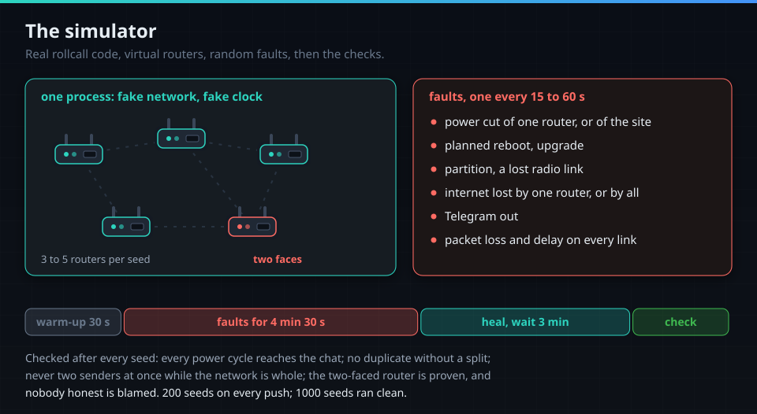
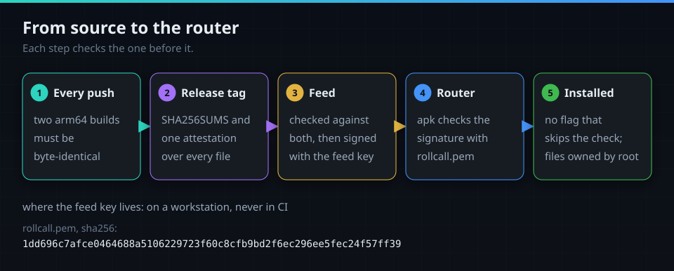
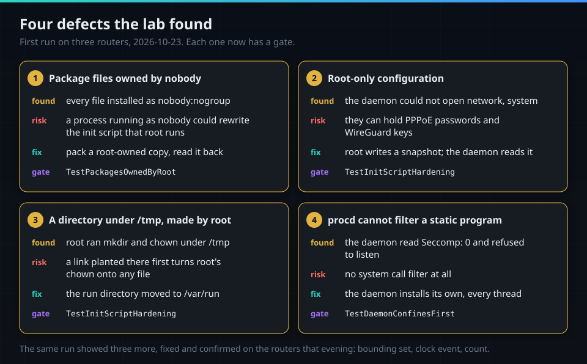

# How it was proven

What checks rollcall, for a reader who does not read Go, and what each check found. The figures
and how they were taken: [measured.md](measured.md); the delivery report:
[reports/v1-report.md](reports/v1-report.md).

## The behaviour, in plain words

Each scenario in `features/*.feature` is bound to a named test, and the gate
`TestFeatureBindings` fails on a scenario without a test or a binding that names nothing.

| Scenario | Test |
|---|---|
| A router loses power and comes back | `TestPowerLossReported` |
| The router that talks to Telegram loses its internet | `TestSenderLosesInternetOtherTakesOver` |
| No router can reach Telegram for twenty minutes | `TestNobodyReachesTelegram20Min` |
| A planned reboot reads differently from a crash | `TestPlannedVsCrash` |
| An upgrade names the old and the new version | `TestUpgradeReported` |
| A day without incidents leaves the chat empty | `TestQuietDayEmptyChat` |
| A mesh node loses its radio link but stays up | `TestMeshNodeLinkLoss` |
| Separate routers with their own LAN and DHCP form a group | `TestSeparateRoutersFormGroup` |
| A single router works on its own | `TestSingleRouterGroup` |
| A device never paired cannot inject events | `TestUnpairedDeviceCannotInject` |

Five more cover the sandbox: a forbidden call ends the daemon, every thread is filtered, the filter
is the list the package ships, nothing is opened first, and no sandbox means no listening.

## Unit tests

- 871 tests pass, 0 fail, 4 skip, plus 913 subtests (`go test ./... -count=1 -json` on `cafed12`).
- 94.4% of the statements of `internal/...` run under a test; CI measures 90.3% over the whole
  module with the race detector, and fails below the committed floor of 90.0%.
- The four skips need what a laptop lacks: two read what CI prepares, one needs a raw socket, and
  one a link-local address that macOS's loopback does not have.
- Every test added for a defect was first run against the unfixed code and failed there.

## The simulator

- Real rollcall code runs as 3 to 5 virtual routers in one process, on a fake network with a fake
  clock; one router shows two faces.
- For four and a half minutes, faults hit every 15 to 60 s: power cuts, reboots, upgrades,
  partitions, internet and Telegram outages, packet loss and delay.
- Then the network heals, and three minutes later seven invariants are checked.
- 200 seeds run on every push; 1000 seeds, run twice in strict mode, were all clean.
- A failing seed prints the command that replays it.

## Gates that must fail

- 18 gates check rules that no unit test owns, such as the init script, the package owners or the
  dependency list.
- `TestGatesHaveTeeth` plants, for each gate, the fault it exists for and requires the gate to
  fail, or requires it to pass on clean input: 123 cases on `cafed12`.
- Examples: an init script without `no_new_privs`, a package file owned by nobody, a module outside
  the allowed list, `InsecureSkipVerify` in the code, the daemon importing `os/exec`, a private key
  in the repository.

## Mutation testing

Planted bugs in the product code, and the share the tests catch (gremlins v0.6.0, CI run
`39990682729` on `4186091`; it reports and does not gate):

| Package | Caught | Package | Caught |
|---|---|---|---|
| replay | 100% | pairing | 85% |
| epoch | 94% | elect | 85% |
| roster | 93% | sig | 80% |
| history | 91% | wire | 80% |
| deliver | 91% | node | 75% |

- The survivors read in `sig`, `wire` and `epoch` change nothing a test could see (capacity hints,
  constants). `node` is the package to raise.

## Builds and the real daemon in CI

- Two arm64 builds of every push must be byte-identical.
- A release attests every file with build provenance; the feed signs a package only after its
  checksum and attestation verify.
- On every push the real `rollcalld` runs under its own filter on x86_64 (75 calls), aarch64 (74)
  and arm (87): it serves status, binds port 7432 and forms a group.
- The same daemon built with one call missing from its list is killed by SIGSYS: the filter is
  really in force.

## The lab run

- Three routers, a Flint 2 and two Beryl AX on OpenWrt 25.12.5, on 2026-10-23: install, a group of
  three, roles, the chat, an internet cut, a forced and a clean reboot.
- The first run found four defects no test had: package files owned by nobody, root-only
  configuration, a directory under `/tmp` made by root, and procd unable to filter a static program.
- It also showed three more, confirmed fixed on the routers that evening: a full capability
  bounding set, a daemon that never learned the clock had synced, and a confirmation count of 0 on
  a reboot both other routers saw.
- The release candidate then went in from the signed feed; each daemon and its numbers:
  [measured.md](measured.md#footprint-per-router-2157).

## Not proven yet

The list is in the [README](../README.md#not-yet) and in [measured.md](measured.md#not-yet): no
mesh, no NAT and no MIPS on hardware yet, no sysupgrade, no pulled power cord, no flash wear over
days.
